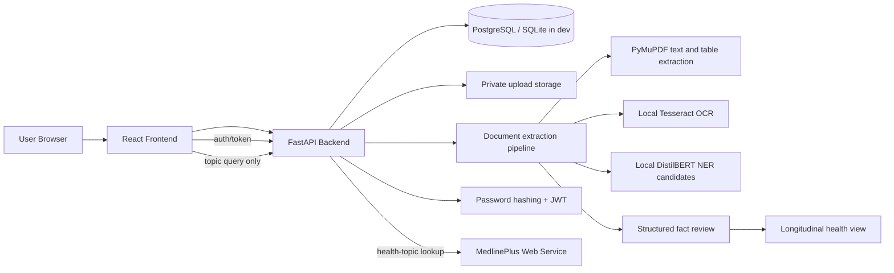

# MediCare architecture

## Request flow

1. A user signs up or logs in through the React frontend.
2. The frontend sends authenticated requests to the FastAPI API.
3. The API validates the user and stores private records under the authenticated user ID.
4. The API enforces a size limit, checks the file extension and content signature, validates image/PDF structure, extracts sorted PDF text and detected tables with PyMuPDF, and uses local Tesseract OCR for scanned pages when configured.
5. Explicitly labeled candidate facts and selected local NER suggestions are generated from document text and stored with source excerpts and page references. NER runs on the backend and does not send records to a provider. Candidates appear on the timeline immediately with an extracted/unconfirmed label and remain editable or dismissible.
6. The user’s timeline includes extracted and confirmed facts, ordered by an explicitly stated clinical event date when available. Missing event dates remain undated instead of being replaced with upload dates. Timeline edits preserve the original source excerpt and whether the user confirmed the fact.
7. The separate Health information page makes an external topic-only request to MedlinePlus without changing the personal-record ownership model.
8. The records-question endpoint searches only that user's accepted facts with deterministic keyword matching and returns the associated source citations or an insufficient-evidence result. It does not call an LLM or send record contents to an external service.
9. The separate Health information page sends only the topic entered by the user to MedlinePlus. It displays attributed, sanitized snippets and links to official topic pages; no personal record context is included.

Image-only documents and PDF pages with no extractable text use local Tesseract OCR when enabled and available. Only blank PDF pages are rendered, with PDFium, for OCR. OCR and NER-derived facts are tagged in their source excerpts and visibly distinguished from user-confirmed facts while still appearing on the timeline. The DistilBERT model is loaded locally from the Hugging Face cache and runs on CPU; downloading model files does not transmit document text. If the configured NER model cannot load, upload reports the failure rather than silently presenting rule-only extraction as complete.

## Security boundaries

- Users can access only their own records.
- Uploaded documents never become public assets.
- Original files are downloaded through an authenticated, owner-scoped endpoint with private/no-store response headers.
- Uploads are limited to 10 MB and supported PDF, PNG, JPEG, UTF-8 TXT, and UTF-8 MD content. PDFs are limited to 100 pages and images to 40 megapixels.
- Passwords are hashed with bcrypt.
- Access tokens are signed JWTs in short-lived HttpOnly, SameSite=Lax cookies and are not returned in login JSON.
- Unsafe cookie-authenticated requests require a matching CSRF cookie/header pair.
- Cookies use the `Secure` attribute when `SECURE_COOKIES=true`; enable this in HTTPS deployments.
- The Vite development proxy keeps browser API requests same-origin.
- The backend keeps evidence and document provenance separate from patient claims.
- PyMuPDF is used under its AGPL-3.0 license option; distribution must meet the applicable license terms.
- The MedlinePlus integration validates result links to HTTPS MedlinePlus domains, bounds response size and wait time, and caches results in process for 12 hours. Multi-worker deployments require a shared rate limiter to enforce the upstream per-IP quota.
