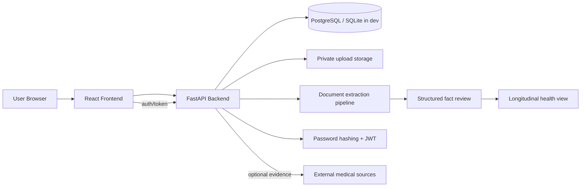

# MediCare architecture

## Request flow

1. A user signs up or logs in through the React frontend.
2. The frontend sends authenticated requests to the FastAPI API.
3. The API validates the user and stores private records under the authenticated user ID.
4. The API enforces a size limit, checks the file extension and content signature, validates image/PDF structure, and extracts visible text where supported.
5. Structured facts are generated from document text and presented for review.
6. Accepted facts become the user’s longitudinal timeline.
7. Future evidence retrieval flows can enrich context without changing the ownership model.

Image-only documents and PDF pages with no extractable text use local Tesseract OCR when enabled and available. Only blank PDF pages are rendered, with PDFium, for OCR. OCR-derived facts are tagged in their source excerpts and the document is marked for OCR review. If the engine is unavailable or no text is recognized, the document remains subject to manual review; no facts are fabricated. OCR runs in a worker thread with page, image-pixel, per-process, and per-document processing limits.

## Security boundaries

- Users can access only their own records.
- Uploaded documents never become public assets.
- Original files are downloaded through an authenticated, owner-scoped endpoint with private/no-store response headers.
- Uploads are limited to 10 MB and supported PDF, PNG, JPEG, UTF-8 TXT, and UTF-8 MD content. PDFs are limited to 100 pages and images to 40 megapixels.
- Passwords are hashed with bcrypt.
- Access tokens are signed JWTs in short-lived HttpOnly, SameSite=Lax cookies and are not returned in login JSON.
- Unsafe cookie-authenticated requests require a matching CSRF cookie/header pair.
- Cookies use the `Secure` attribute when `SECURE_COOKIES=true`; enable this in HTTPS deployments.
- The Vite development proxy keeps browser API requests same-origin.
- The backend keeps evidence and document provenance separate from patient claims.
